# zonyo user guide

zonyo is the till and the lock for a gaming café, cyber café or esports lounge. It has two parts:

- **zonyo Server** runs on the counter PC. It is where staff sell time, see every station, settle bills and read the
  reports.
- **zonyo Client** runs on each gaming PC. It shows the customer a countdown, warns them before the end, and locks the
  screen the moment their time runs out. Only staff can open it again.

Everything runs on your own network. There is no cloud, no account and no subscription, and running the café needs no
internet. The one exception is updates: a gaming PC needs the internet to check an update's fingerprint before it installs
it.

This guide takes you from nothing to your first customer, then explains every part of the app. If you are setting up for
the first time, read **Part 1** and **Part 2**. The rest is there when you need it.

In the pictures, **blue numbered boxes** show what to click. The numbers match the steps under each picture. Everything
shown is demo content: the café, its PCs, the customers' sessions and the takings are made up.

## Contents

**Part 1. Get started**
1. [What you need](#1-what-you-need)
2. [Install zonyo Server on the counter PC](#2-install-zonyo-server-on-the-counter-pc)
3. [The first start and your recovery key](#3-the-first-start-and-your-recovery-key)
4. [Install zonyo Client on each gaming PC](#4-install-zonyo-client-on-each-gaming-pc)
5. [When a PC does not appear](#5-when-a-pc-does-not-appear)
6. [A tour of the Floor](#6-a-tour-of-the-floor)

**Part 2. Sell time**
7. [Start a session by the hour](#7-start-a-session-by-the-hour)
8. [Sell a package](#8-sell-a-package)
9. [Prepaid: the customer pays first](#9-prepaid-the-customer-pays-first)
10. [Add time or take time off](#10-add-time-or-take-time-off)
11. [Time is up: settle the bill](#11-time-is-up-settle-the-bill)
12. [Cancel a bill](#12-cancel-a-bill)
13. [Lock, unlock, pause and message a PC](#13-lock-unlock-pause-and-message-a-pc)
14. [See a PC's screen](#14-see-a-pcs-screen)

**Part 3. Stations**
15. [The Stations page](#15-the-stations-page)
16. [Number, name and price a station](#16-number-name-and-price-a-station)
17. [Consoles, VR and pool tables](#17-consoles-vr-and-pool-tables)

**Part 4. Money**
18. [Prices, currency and rounding](#18-prices-currency-and-rounding)
19. [Packages](#19-packages)
20. [Free sessions: a club that does not charge](#20-free-sessions-a-club-that-does-not-charge)
21. [Reports](#21-reports)
22. [Export a PDF or Excel report](#22-export-a-pdf-or-excel-report)
23. [The audit log](#23-the-audit-log)

**Part 5. Make it yours**
24. [Your shop name and lock-screen text](#24-your-shop-name-and-lock-screen-text)
25. [Lock-screen pictures and the wallpaper](#25-lock-screen-pictures-and-the-wallpaper)
26. [Languages](#26-languages)
27. [Spoken warnings and the voice](#27-spoken-warnings-and-the-voice)
28. [Light and dark](#28-light-and-dark)

**Part 6. On the gaming PC**
29. [What the customer sees](#29-what-the-customer-sees)
30. [The staff unlock PIN](#30-the-staff-unlock-pin)
31. [Why customers cannot get round it](#31-why-customers-cannot-get-round-it)

**Part 7. Security, phone and upkeep**
32. [Security settings](#32-security-settings)
33. [Your recovery key: reinstalling the Server](#33-your-recovery-key-reinstalling-the-server)
34. [The web companion on your phone](#34-the-web-companion-on-your-phone)
35. [Updates](#35-updates)
36. [Your data and daily backups](#36-your-data-and-daily-backups)
37. [If something goes wrong](#37-if-something-goes-wrong)
38. [Uninstalling](#38-uninstalling)
39. [Words you will see](#39-words-you-will-see)
40. [Get help](#40-get-help)

---

# Part 1. Get started

## 1. What you need

- **A counter PC** for zonyo Server: Windows 10 or 11, 64-bit. Any ordinary office PC is enough. The Server also runs on
  Linux.
- **The gaming PCs** for zonyo Client: Windows 10 or 11, 64-bit.
- **One network** that the counter PC and the gaming PCs share: the café's router or switch, wired or Wi-Fi. No internet
  is needed to run the café. To install updates, the counter PC and the gaming PCs need the internet: the gaming PCs use
  it to check each update's fingerprint, so nothing on the café network can slip in a fake one.
- **Optional:** a phone or tablet on the same Wi-Fi, to run the floor while you walk around.

## 2. Install zonyo Server on the counter PC

1. Download **zonyo-Server-Setup.exe** from [zylio.net/software/zonyo](https://zylio.net/software/zonyo).
2. Open it. Windows asks for permission to install; click **Yes**.
3. If Windows shows **"Windows protected your PC"**, click **More info**, then **Run anyway**. Windows shows this because
   zonyo's installer is not code-signed yet, so Windows does not recognise the publisher.
4. Follow the installer and click **Finish**. zonyo Server opens, and from now on starts with Windows.

The installer also opens the Windows firewall for zonyo, so the gaming PCs can reach the Server straight away.

If you used ChronosGG before, the installer upgrades it in place: your settings, stations and billing history all come with
you.

## 3. The first start and your recovery key

The first time zonyo Server opens, the Floor is empty and shows how to add your first station, with a short checklist on
the right.

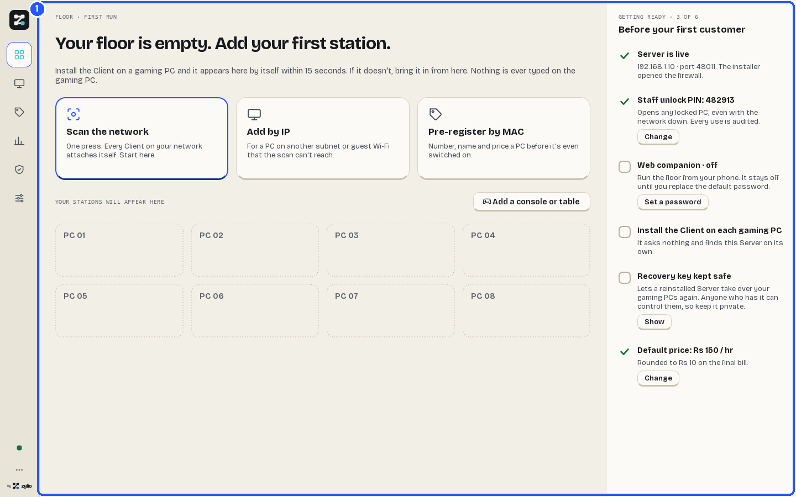

1. The checklist shows what is done and what is left: the Server is live, the **staff unlock PIN** (see
   [section 30](#30-the-staff-unlock-pin)), the **web companion** password (see [section 34](#34-the-web-companion-on-your-phone)),
   installing the Client on each gaming PC, your **recovery key**, and the default price. Each item that needs you has a
   button next to it.

At the first start zonyo also shows your **recovery key**. Please read this screen.

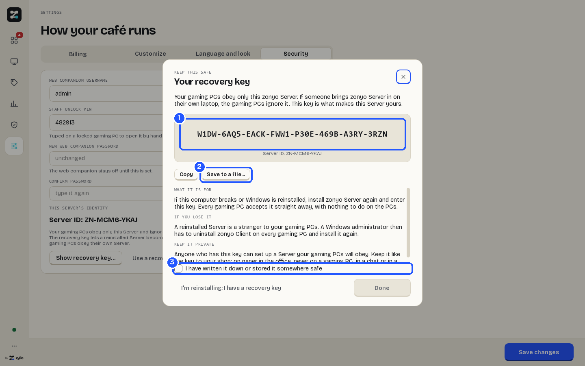

1. This is your recovery key: eight groups of four letters and numbers. It is what makes this Server *your* Server.
2. Click **Save to a file…** to keep a copy, or **Copy**. Better still, write it on paper and keep it in the office.
3. Tick **I have written it down or stored it somewhere safe**, then click **Done**.

**Why it matters.** Your gaming PCs obey only this Server. If someone brings zonyo Server in on their own laptop, your
PCs ignore it. If this counter PC ever breaks, you install zonyo Server again and type this key, and every gaming PC
accepts the new Server at once, with nothing to do on the PCs. Without the key, an administrator would have to reinstall
zonyo Client on every gaming PC.

**Keep it private.** Anyone with the key can set up a Server your gaming PCs will obey. Never keep it on a gaming PC, in
a chat or in a photo. You can see it again at any time in **Settings → Security → Show recovery key…**.

If this is a reinstall and you already have a key, click **I'm reinstalling: I have a recovery key** instead (see
[section 33](#33-your-recovery-key-reinstalling-the-server)).

## 4. Install zonyo Client on each gaming PC

1. On each gaming PC, download and open **zonyo-Client-Setup.exe**, and click **Yes** when Windows asks.
2. Follow the installer and click **Finish**.

That is all. The Client asks for nothing. It starts with Windows, finds your Server on the network by itself, shows the
lock screen, and appears on the Floor within seconds as a new station waiting for a number. Give it a number (see
[section 16](#16-number-name-and-price-a-station)) and it is ready to sell.

The first time a PC connects, it pairs with your Server. From then on it obeys only your Server.

## 5. When a PC does not appear

Café networks are rarely tidy: guest Wi-Fi that keeps devices apart, two separate networks, a strict firewall. When a PC
does not show up on its own, fix it from the Server. Click **Add station** on the Floor (or **Add a gaming PC** on the
Stations page).

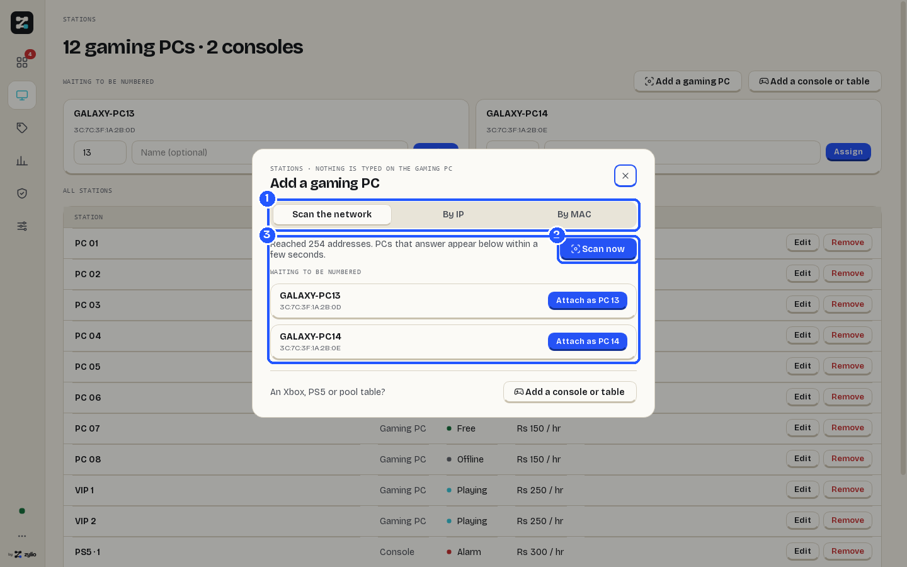

1. Three tabs: **Scan the network**, **By IP** and **By MAC**.
2. **Scan now** reaches every address on your network. PCs running the Client answer and attach themselves.
3. New PCs appear in the list below within a few seconds. Give each one a number.

If a PC sits on another part of the network that the scan cannot reach, use **By IP**:

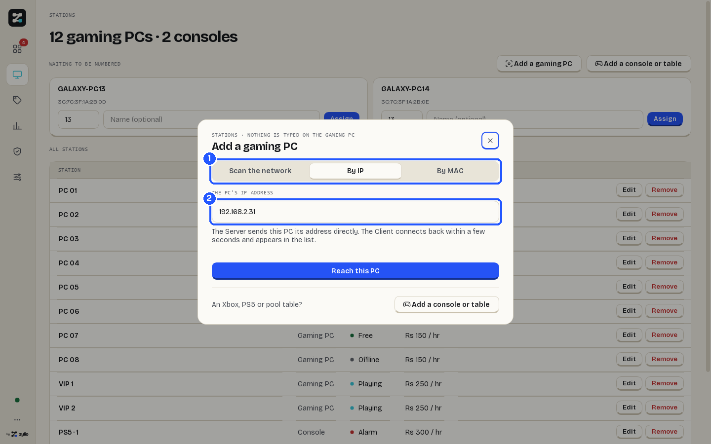

1. Click **By IP**.
2. Type the PC's address, such as `192.168.2.31`, and click **Reach this PC**.

You can also register a PC before it has ever connected, with its number, name and price, using its network card's
**MAC address**:

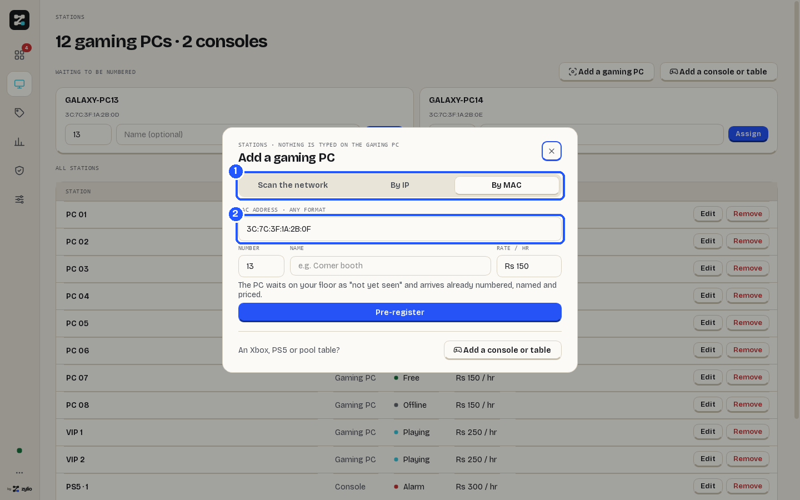

1. Click **By MAC**.
2. Type the MAC address (such as `3C:7C:3F:1A:2B:0F`), the number, an optional name and the price, then click
   **Pre-register**. The PC takes that place on the floor as soon as it connects.

A PC is known by its network card, so it keeps its number, price and history when its IP address changes.

## 6. A tour of the Floor

The Floor is zonyo Server's main screen.

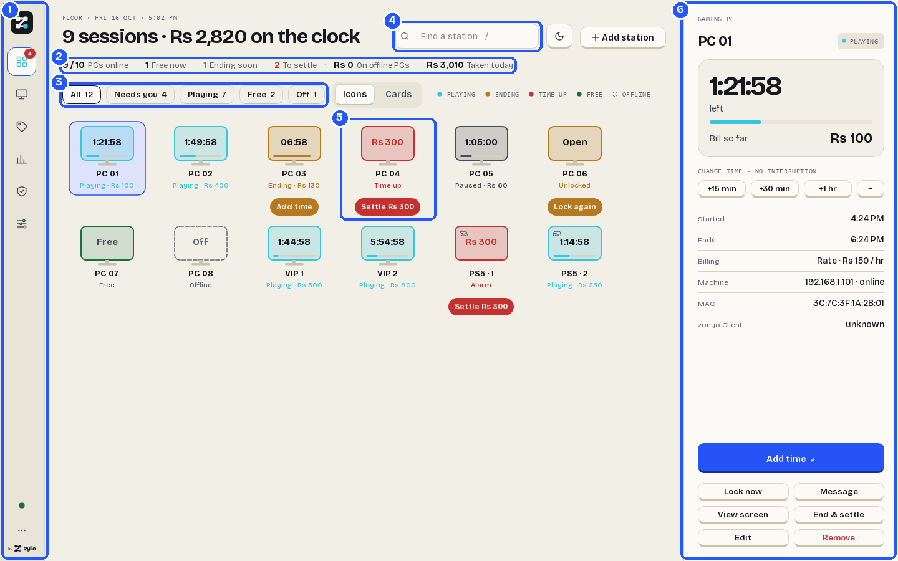

1. **The menu.** Floor, Stations, Packages, Reports, Audit and Settings. Hover an icon to see its name. The green dot at
   the bottom is the Server's status; hover it for its address and how many PCs are connected. The **⋯** button opens
   more: the web companion link, updates, and quitting.
2. **The numbers line:** PCs online, free now, ending soon, waiting to be settled, money on PCs that stopped answering,
   and today's takings. Amber and red appear only where something needs you.
3. **Filters:** All, Needs you, Playing, Free and Off.
4. **Find a station.** Press `/` and type a name or number.
5. **A station.** Its little screen shows the time left or the amount to collect, in its status colour. A station that
   needs you has its one action right underneath, such as **Settle Rs 300**, **Add time** or **Lock again**.
6. **The side panel** shows everything about the station you clicked.

Click any station to fill the side panel:

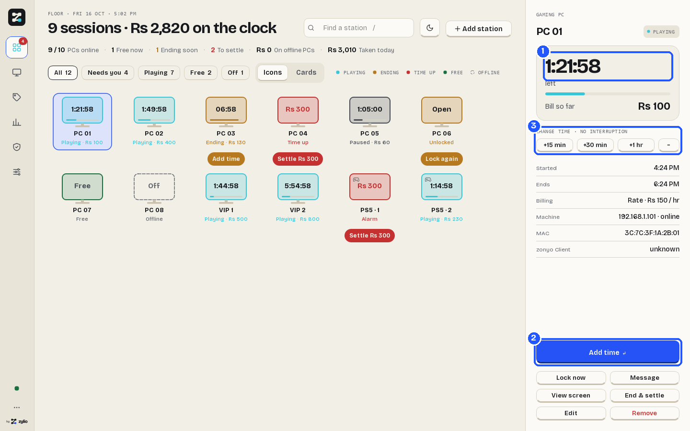

1. The time left (or the amount to collect) and the bill so far.
2. The one big blue key does the next step for this station: **Start session**, **Add time**, **Settle**. Press `Enter` to
   press it.
3. Quick changes: **+15 min**, **+30 min**, **+1 hr**, and **−** to take time off. The customer keeps playing.

Below them: when it started and ends, how it is billed, its address and MAC, and buttons such as **Lock now**,
**Message**, **View screen**, **End & settle**, **Edit** and **Remove**. You can also right-click any station for the
same actions.

Prefer bigger cards? Switch the view:

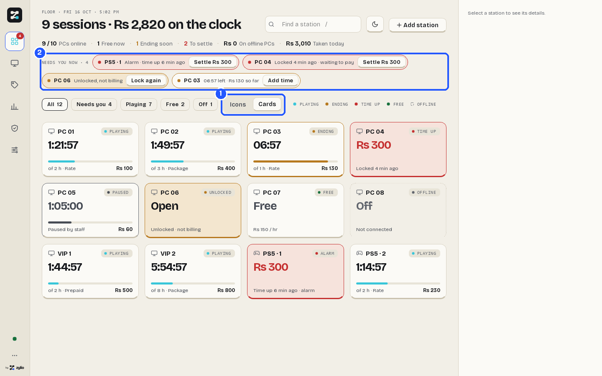

1. **Icons** or **Cards**. zonyo remembers your choice.
2. In the cards view, the stations that need you line up as tags at the top, each with the button that fixes it.

**Status colours:** blue is playing, amber is ending soon, red is time up (waiting to be settled), green is free, and a
dashed outline is off or not connected.

---

# Part 2. Sell time

## 7. Start a session by the hour

Click a free station, then **Start session** in the side panel (or right-click it → **Start session**).

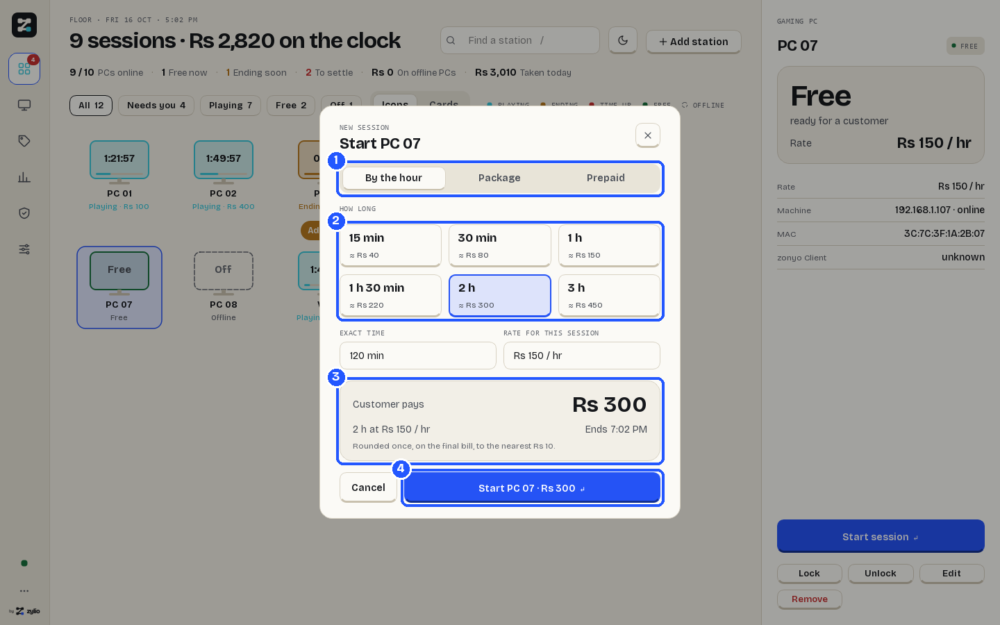

1. Choose how to bill: **By the hour**, **Package** or **Prepaid**.
2. Pick how long: 15 minutes to 3 hours, or type an exact number of minutes under **Exact time**. You can also change the
   **Rate for this session**.
3. Check what the customer pays and when the time ends. The bill is rounded once, on the final total.
4. Click **Start**. The PC unlocks at once and the countdown appears on its screen.

By the hour is billed by the minute at the station's hourly rate. If the customer stops early, they pay for the time they
actually played.

## 8. Sell a package

A package is a fixed price for a block of time, such as "3 Hours, Rs 400". Set your packages up first (see
[section 19](#19-packages)).

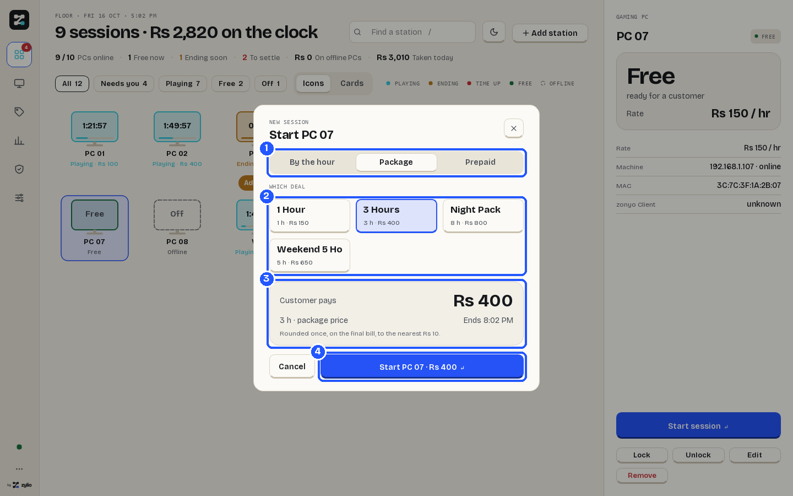

1. Click **Package**.
2. Pick the deal.
3. Check the price and the end time.
4. Click **Start**.

A package keeps its price even if you edit the deal later.

## 9. Prepaid: the customer pays first

For a pay-first counter: the customer hands over money and zonyo works out how long it buys.

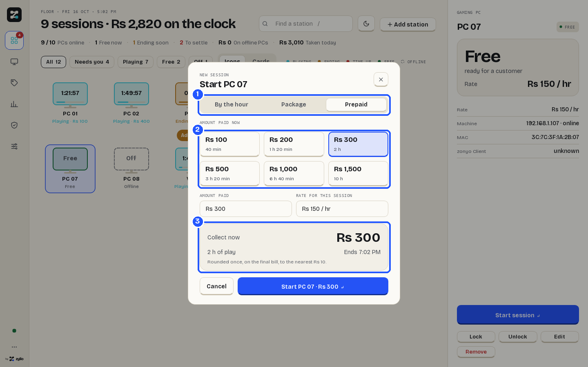

1. Click **Prepaid**.
2. Pick the amount paid, or type it under **Amount paid**.
3. zonyo shows how much time that buys and when it ends. Click **Start**.

The money is collected now. When the session ends, zonyo only asks for anything still owed, so a prepaid customer is never
asked to pay twice.

## 10. Add time or take time off

Click the station, then **Add time** (or use **+15 min**, **+30 min** or **+1 hr** in the side panel).

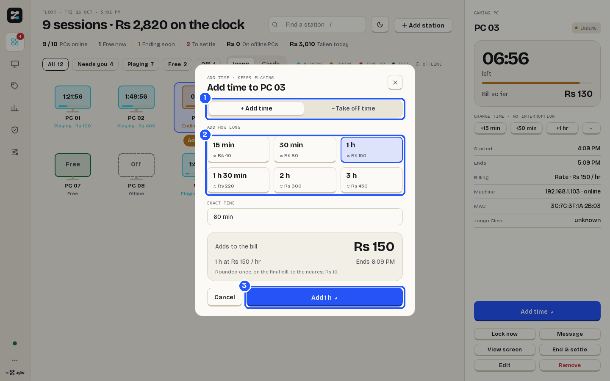

1. **+ Add time** or **− Take off time**.
2. Pick how much, or type an exact number of minutes.
3. Check the new end time and the change to the bill, then click **Add** (or **Take off**).

The customer keeps playing; nothing is interrupted. Only time still left can be taken off, never minutes already played.
By the hour, the bill follows the time; a package keeps its price; prepaid comes down at the session's rate. Every change
goes into the audit log.

## 11. Time is up: settle the bill

When the time runs out, the gaming PC locks itself and its station turns red with **Settle** underneath. The bill stops at
the moment the PC locked: time after that is never charged.

Click **Settle** under the station (or in the side panel).

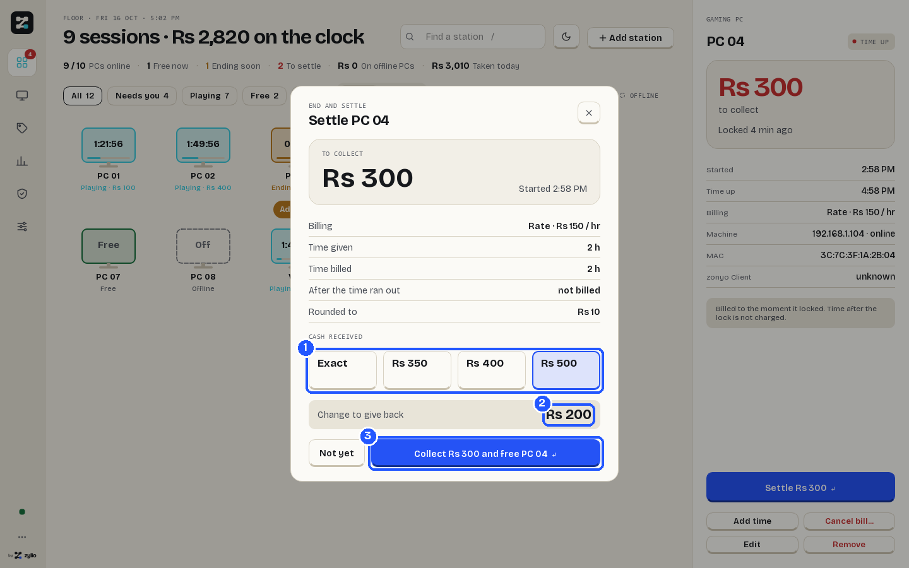

1. Pick the cash the customer handed over: **Exact**, or one of the amounts.
2. zonyo shows the change to give back.
3. Click **Collect … and free PC 04**. The station is ready for the next customer.

The lines above show how the bill was worked out: the billing, the time given and billed, anything added, and the
rounding. Click **Not yet** to close the sheet without settling.

To end a session before its time is up (the customer is leaving early), click **End & settle** in the side panel.

For a prepaid customer who has already paid, there is nothing more to collect:

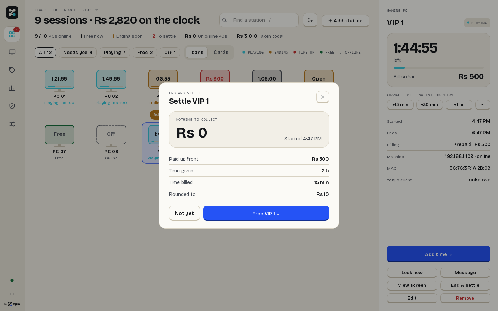

## 12. Cancel a bill

If a customer walks out without paying, staff made a mistake, or it was a test, cancel the bill instead of settling it.
Click the station, then **Cancel bill…** in the side panel.

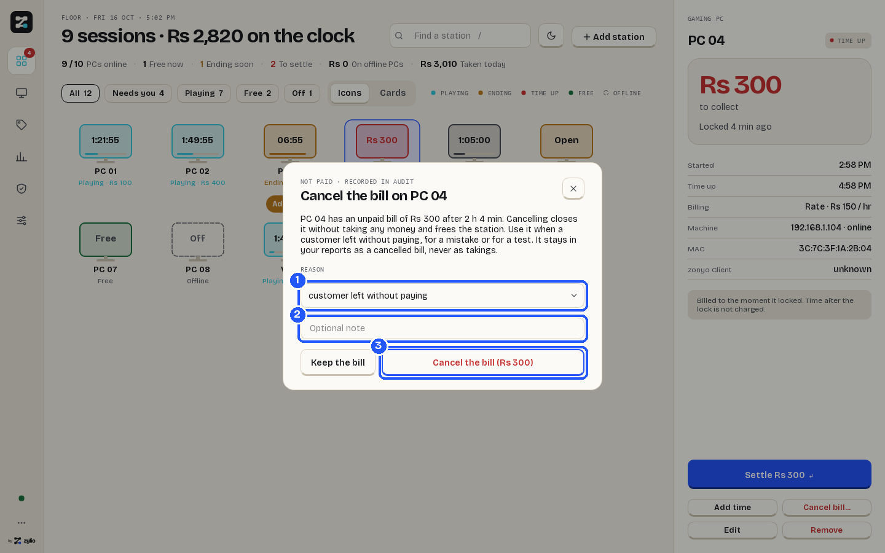

1. Choose the reason: customer left without paying, staff error, test session, hardware fault, or other.
2. Add a note if you like.
3. Click **Cancel the bill**. The station is freed without taking any money.

A cancelled bill is never counted as takings. It shows in Reports under **Cancelled bills** and in the audit log with its
reason. If the customer had prepaid, that money stays in the day's takings.

## 13. Lock, unlock, pause and message a PC

From the side panel or the right-click menu:

- **Lock now** pauses a PC that is playing: the screen locks and the customer's remaining time is kept and not billed.
  The PC shows **Paused by staff**. Click **Resume** to carry on.
- **Unlock** opens a free PC without a session, for staff use. It shows on the Floor as **Unlocked · not billing**, so
  free play is never invisible, with **Lock again** underneath.
- **Message** sends a line of text to the PC's screen.

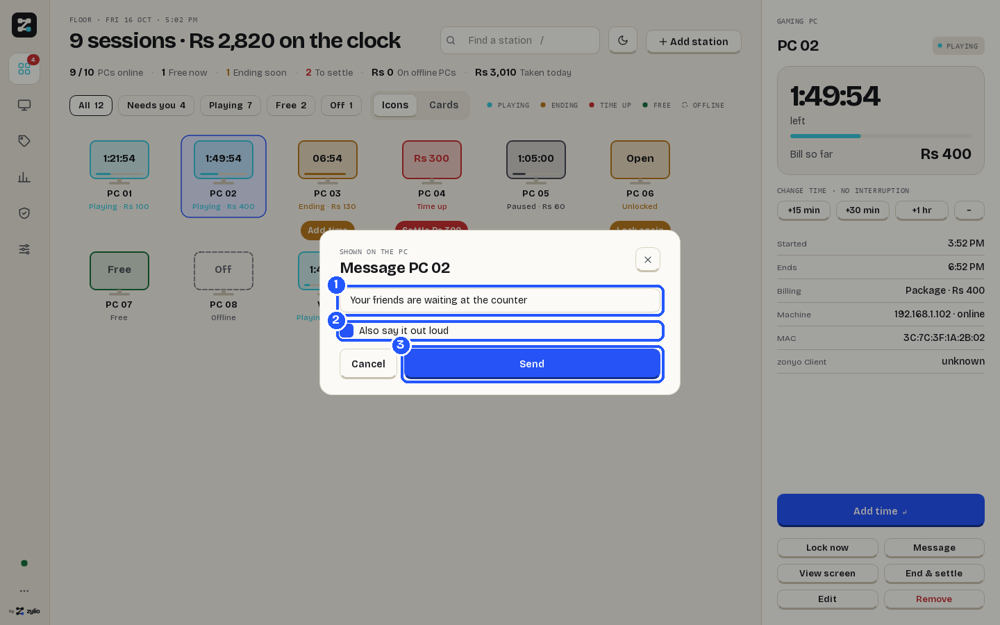

1. Type the message.
2. Tick **Also say it out loud** to have the PC read it aloud.
3. Click **Send**.

## 14. See a PC's screen

Click a playing PC, then **View screen** (or right-click it → **View screen**). The picture opens in its own window, which
you can move to another monitor or make full screen with `F11`.

- The PC sends pictures only while the window is open, so games run at full speed the rest of the time.
- The picture is encrypted on its way to the Server.
- The customer sees a small "Staff is viewing this screen" note at the top, and every view is written to the audit log.

---

# Part 3. Stations

## 15. The Stations page

Click **Stations** in the menu.

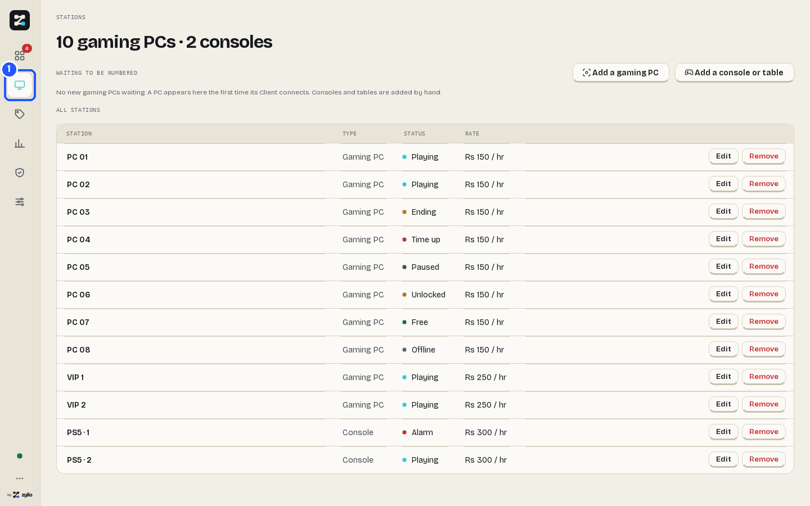

1. **Stations** lists every gaming PC and console with its type, status and hourly price. New PCs waiting for a number
   appear at the top.

Use **Add a gaming PC** for a PC that did not appear on its own (see [section 5](#5-when-a-pc-does-not-appear)), and
**Add a console or table** for anything that cannot run the Client (see
[section 17](#17-consoles-vr-and-pool-tables)). **Edit** and **Remove** are on each row.

## 16. Number, name and price a station

Click **Edit** on a station (or **Edit** in the side panel).

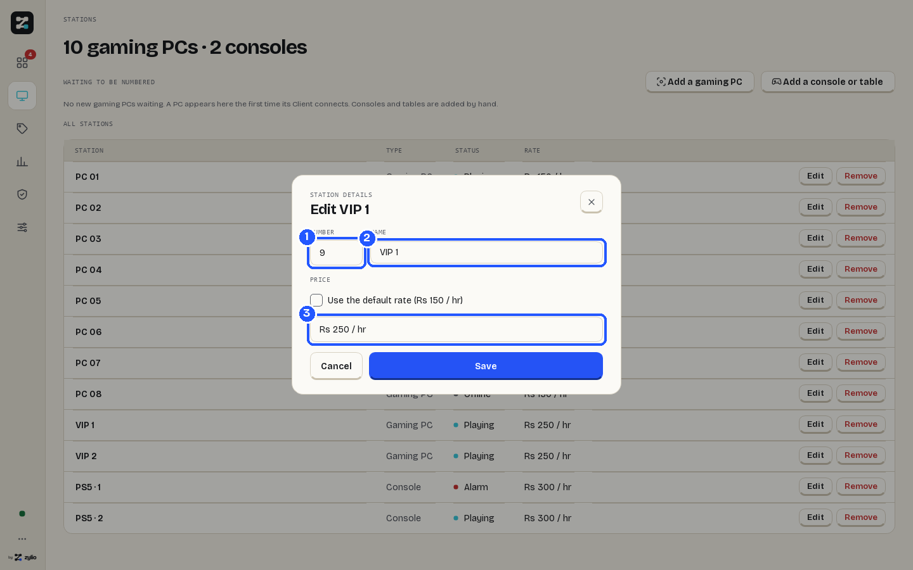

1. The **number** decides where it sits on the Floor.
2. An optional **name**, such as "VIP 1". Without one, it is called "PC" and its number.
3. Its own **price** per hour. Tick **Use the default rate** to follow the price in Settings instead.

Click **Save**. A station with its own price keeps it when you change the default.

## 17. Consoles, VR and pool tables

A PS5, an Xbox, a VR rig or a pool table earns money the same way but cannot run the Client. On the Stations page, click
**Add a console or table**.

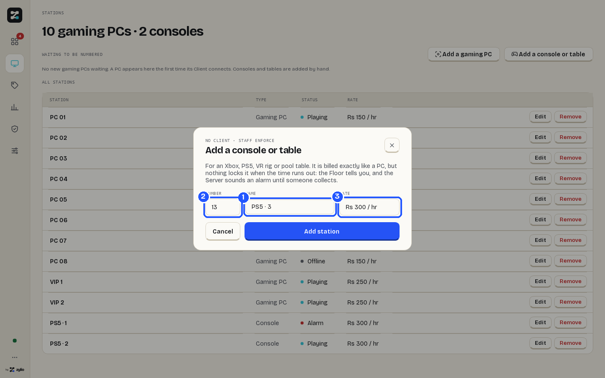

1. Give it a **name**, such as "PS5 · 3".
2. A **number**.
3. Its **price** per hour.

Click **Add station**. It is sold, extended, settled and reported exactly like a PC.

Nothing can switch off a console, so zonyo makes noise instead: a warning 5 minutes before the end, then an alarm at time
up that repeats, more often the longer nobody reacts. Click **Silence** in the side panel (or right-click →
**Silence the alarm**) once you have dealt with it; silencing is written to the audit log. Adding time sets the alarm for
the new end time.

---

# Part 4. Money

## 18. Prices, currency and rounding

Click **Settings** in the menu, then **Billing**.

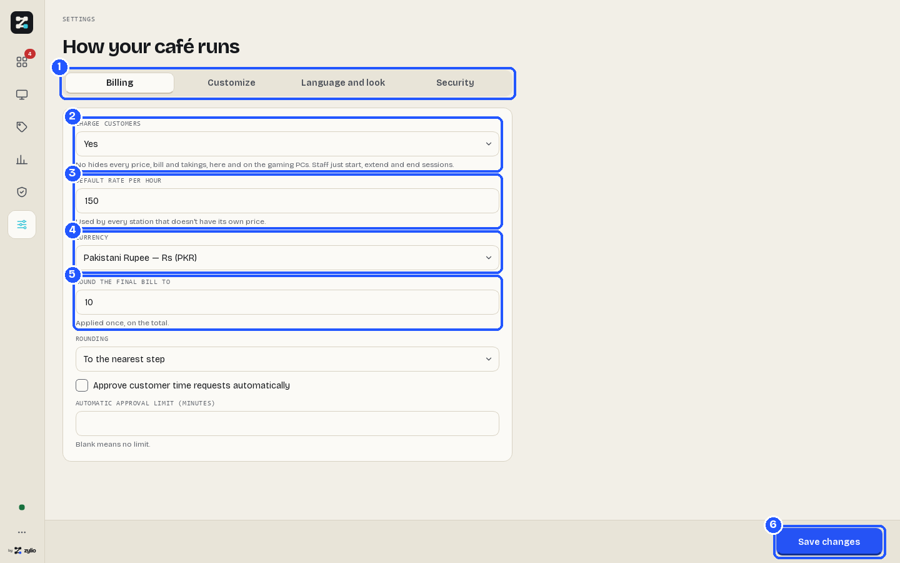

1. The four Settings tabs: **Billing**, **Customize**, **Language and look** and **Security**.
2. **Charge customers:** Yes, or No for a club that does not charge (see
   [section 20](#20-free-sessions-a-club-that-does-not-charge)).
3. **Default rate per hour**, used by every station that does not have its own price.
4. **Currency:** 60 to choose from, each written the local way, such as "Rs 1,500", "1 500 ₽" or "1 500 €".
5. **Round the final bill to**, such as 10. Under **Rounding**, choose **To the nearest step** or **Always up**. The bill is
   rounded once, on the total, so three 10-minute extensions never cost more than one 30-minute extension.
6. Click **Save changes**.

What you type on any tab is kept until you click **Save changes**.

## 19. Packages

Click **Packages** in the menu.

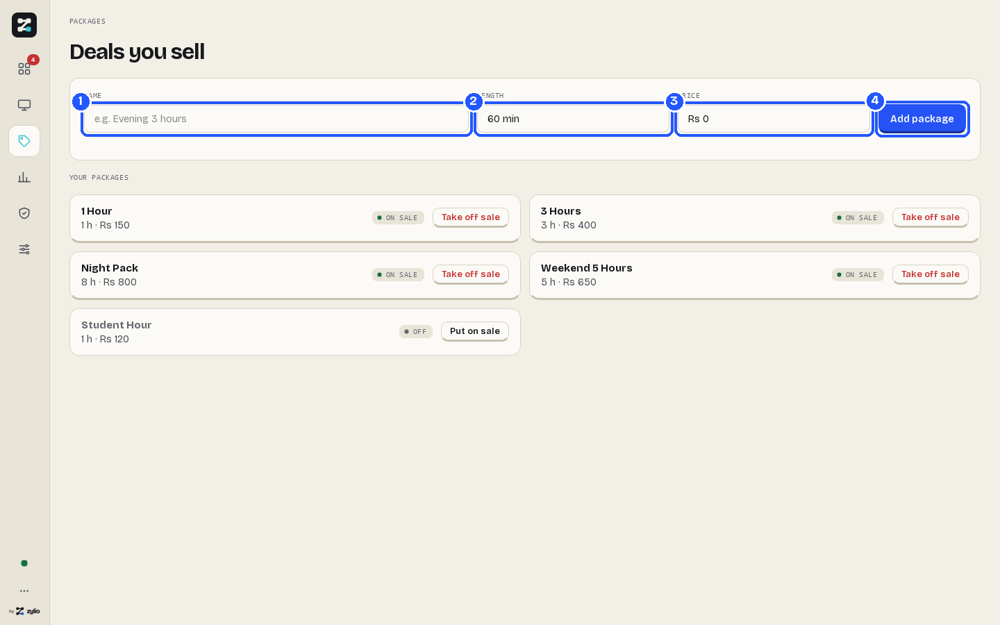

1. The package's **name**, such as "Night Pack".
2. Its **length**, in minutes.
3. Its **price**.
4. Click **Add package**.

Your packages appear below. **Take off sale** hides one from the Start sheet without deleting it; **Put on sale** brings
it back. Packages also appear on the web companion.

## 20. Free sessions: a club that does not charge

For a youth club, a school lab or a staff room: in **Settings → Billing**, set **Charge customers** to **No, sessions are
free** and click **Save changes**.

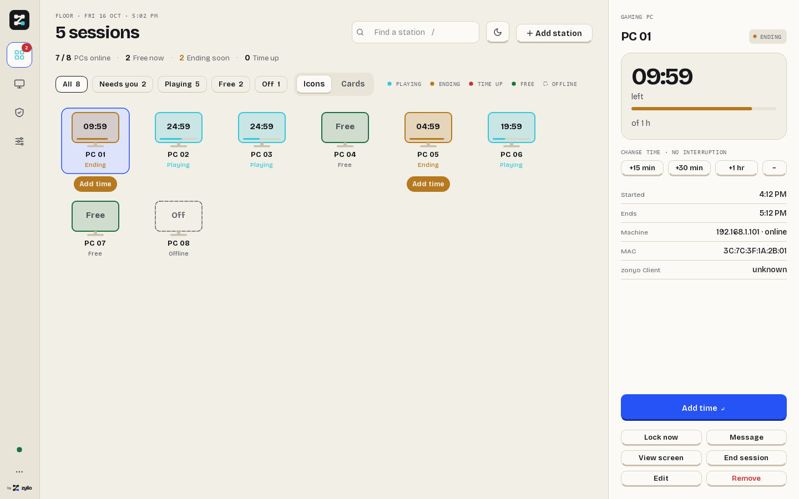

Every price, bill, rate and takings figure disappears: on the Floor, on the gaming PCs and on the web companion. Staff just start, extend and end sessions; **Settle** becomes **End session**, and the gaming PCs say "Ask at the
counter to start" instead of asking for money. Packages and Reports leave the menu.

Switch it back to **Yes** at any time; each station's own price is kept. A session keeps the terms it started with.

## 21. Reports

Click **Reports** in the menu.

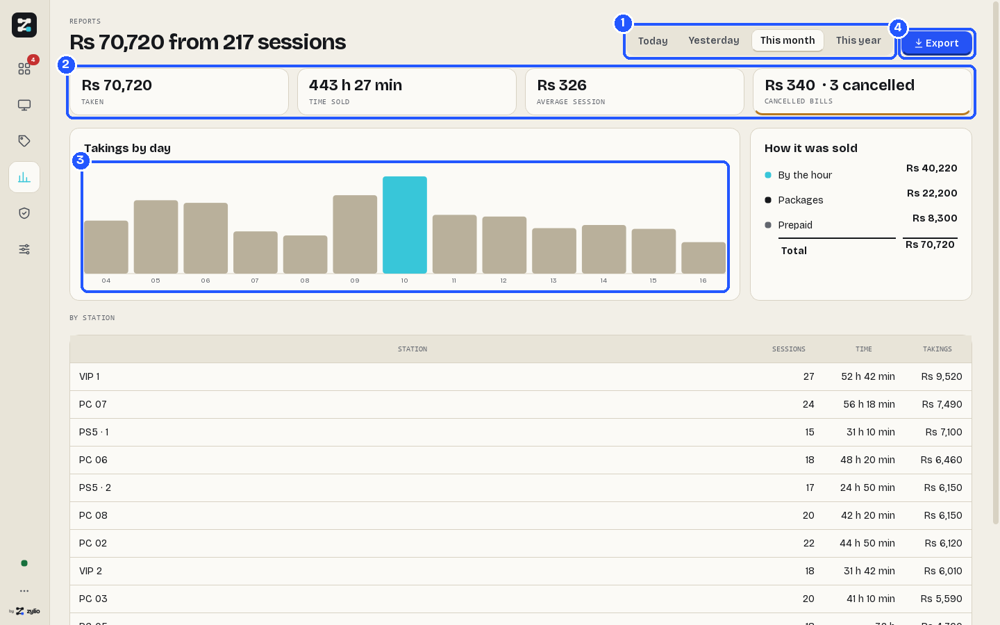

1. Choose the range: **Today**, **Yesterday**, **This month** or **This year**.
2. The totals: takings, time sold, the average session, and cancelled bills.
3. Takings by day, then how it was sold (by the hour, packages, prepaid, consoles) and a table by station. Every
   breakdown adds up to the same total.
4. **Export** saves the report (see [section 22](#22-export-a-pdf-or-excel-report)).

## 22. Export a PDF or Excel report

On the Reports page, click **Export**, choose **PDF** or **Excel** and the range, then click **Export** and choose where
to save it.

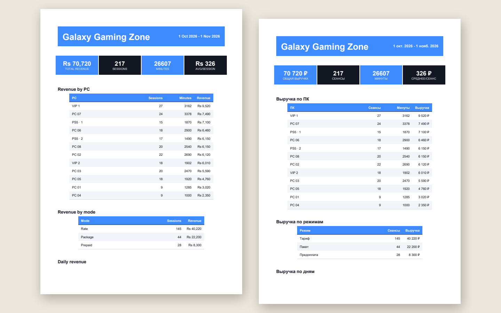

The PDF carries your shop's name, its headings are in the Server's language, prices are in your currency, and PC and
staff names show correctly in any alphabet. The Excel file opens correctly in every language.

## 23. The audit log

Click **Audit** in the menu.

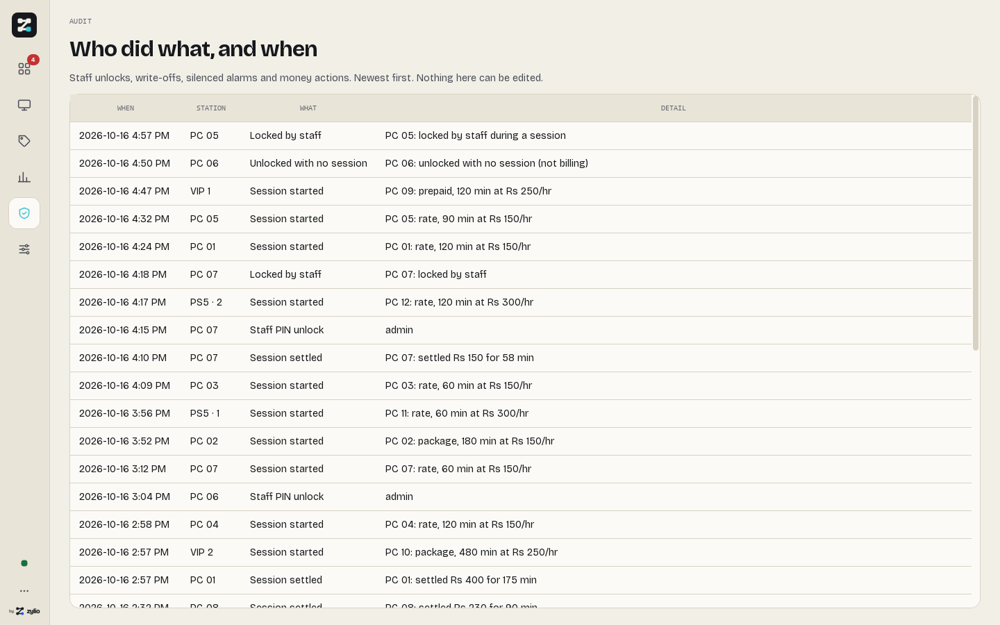

The audit log records who did what, and when: every staff PIN unlock, manual lock and unlock, session started and settled,
time added or taken off, cancelled bill and silenced alarm, with the station and the details. Newest first. Nothing here
can be edited.

---

# Part 5. Make it yours

## 24. Your shop name and lock-screen text

Click **Settings**, then **Customize**.

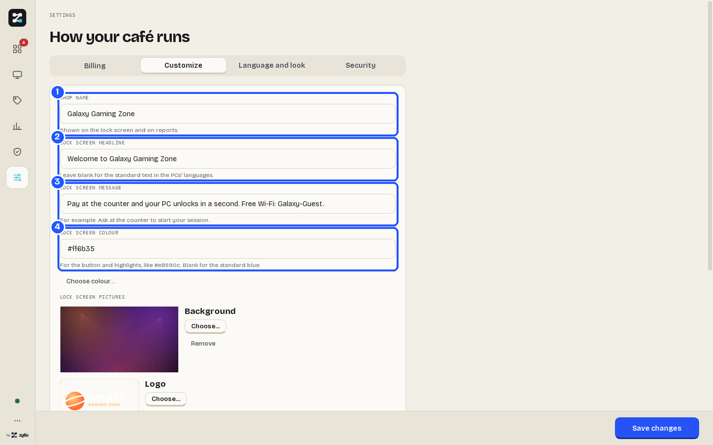

1. **Shop name**, shown at the top of every lock screen and on your reports.
2. **Lock screen headline**, such as "Welcome to Galaxy Gaming Zone". Leave it blank for the standard text in the PCs'
   languages.
3. **Lock screen message**, such as "Pay at the counter and your PC unlocks in a second."
4. **Lock screen colour** for the Unlock button and highlights, such as `#ff6b35`. Click **Choose colour…** to pick one, or
   leave it blank for the standard blue.

Click **Save changes**. Your headline and message replace the standard words on the waiting screen; the time-up and
paused screens keep theirs, so customers always know what happened.

## 25. Lock-screen pictures and the wallpaper

Further down the **Customize** tab:

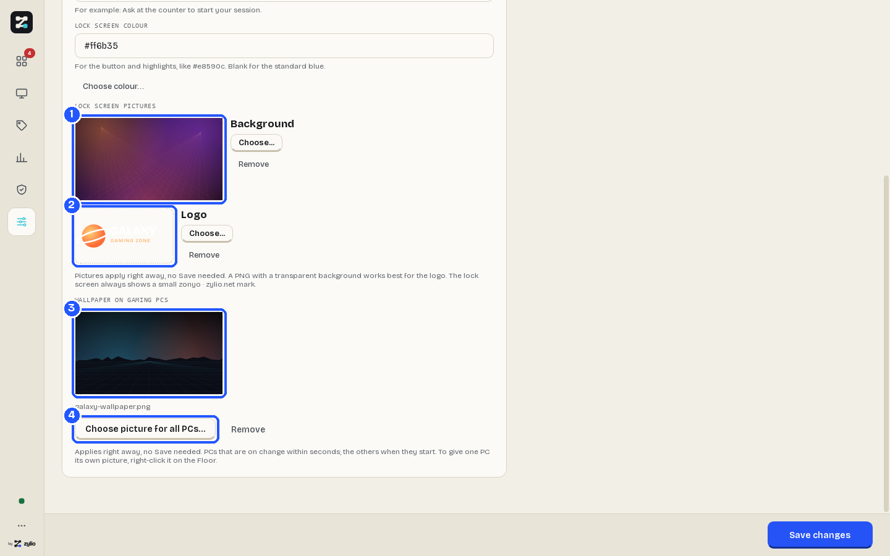

1. **Background:** click **Choose…** and pick a picture for the lock screen.
2. **Logo:** your shop's logo, shown in the middle of the lock screen. A PNG with a transparent background works best.
3. **Wallpaper on gaming PCs:** one desktop wallpaper for every gaming PC.
4. **Choose picture for all PCs…** picks it. **Remove** gives each PC its own wallpaper back.

Pictures apply straight away, with no need to save. PCs that are on change within seconds, and the others when they start.
Each PC keeps a copy, so your lock screen shows even when a PC starts with no network. To give one PC its own wallpaper,
right-click it on the Floor → **Wallpaper for this PC…**; **Use the shop wallpaper** puts it back.

This is what a customer sees:

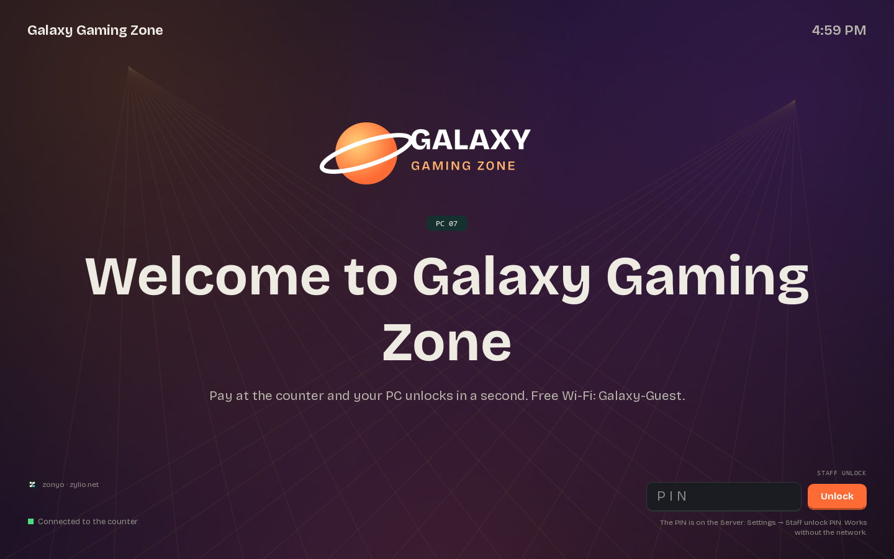

A small "zonyo · zylio.net" mark always stays in one corner.

## 26. Languages

Click **Settings**, then **Language and look**.

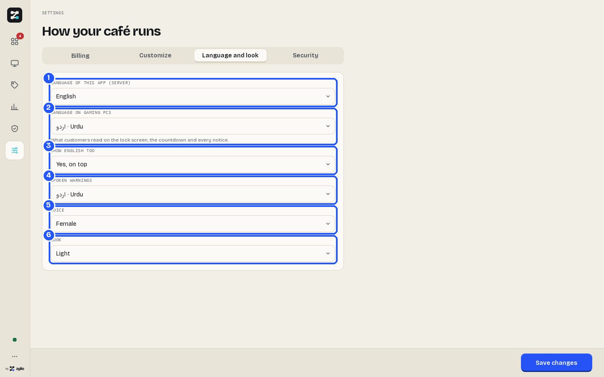

1. **Language of this app (Server):** 30 languages. The window switches at once, right to left for Urdu, Arabic, Persian,
   Pashto and Punjabi.
2. **Language on gaming PCs:** what customers read on the lock screen, the countdown and every notice.
3. **Show English too:** **Yes, on top** (English first, your language underneath), **Yes, underneath** (your language
   first), or **No** (your language only).
4. **Spoken warnings** (see [section 27](#27-spoken-warnings-and-the-voice)).
5. **Voice:** female or male.
6. **Look:** light or dark (see [section 28](#28-light-and-dark)).

Click **Save changes**. Every gaming PC follows within a second, with the right font for each language, and right to left
where the language is.

| Urdu first, English underneath | Russian only |
|---|---|
| 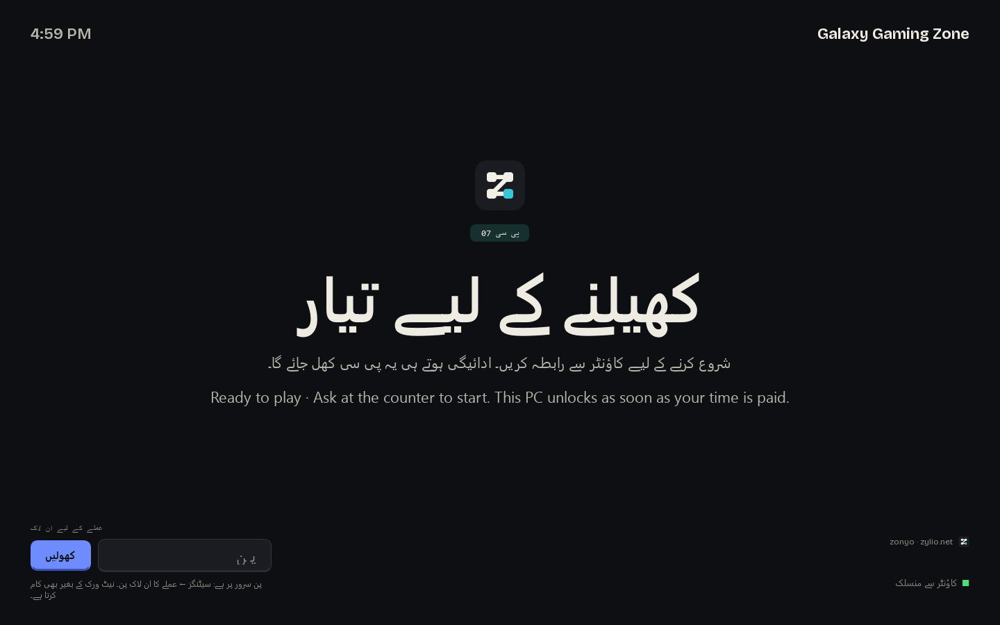 | 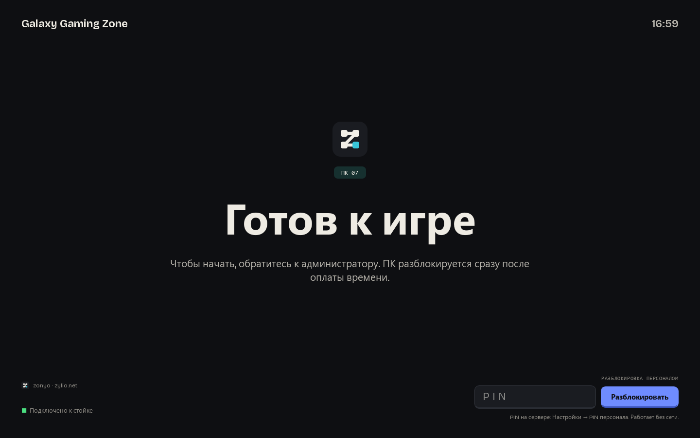 |

The Server in Urdu and in Russian:

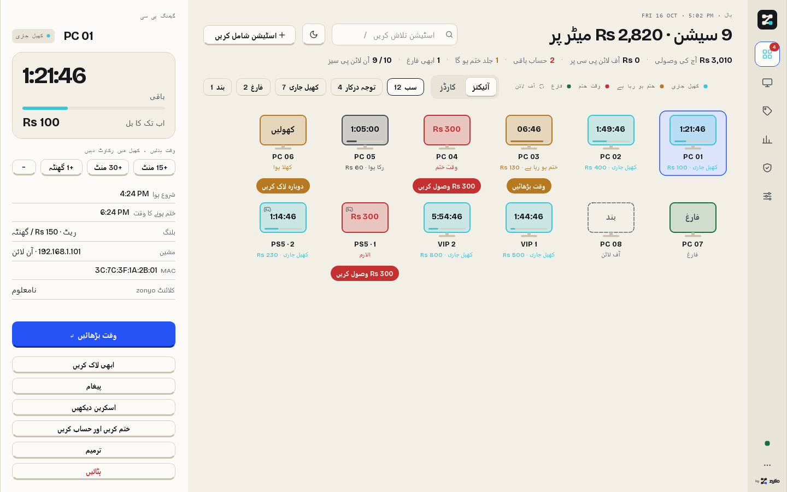

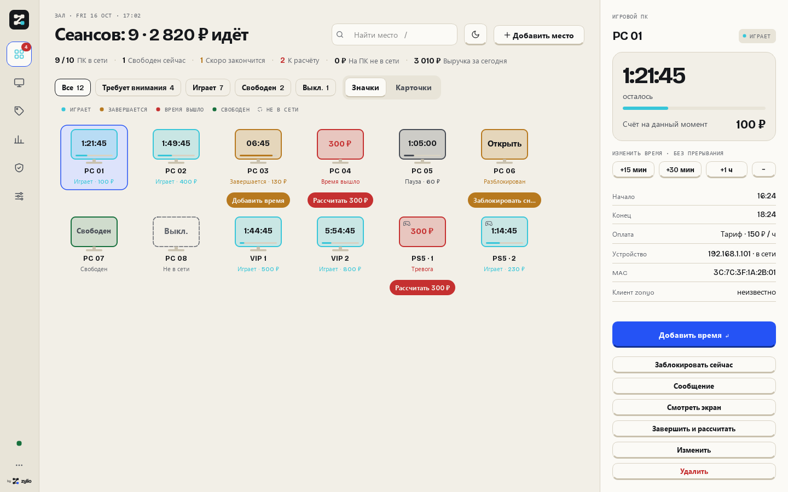

Clocks follow the language: 24-hour times for Russian and most other languages, 12-hour for English, Urdu and a few
others.

## 27. Spoken warnings and the voice

The gaming PCs speak at the important moments: welcome, 10 and 5 minutes left, time up, time added and goodbye. In
**Settings → Language and look**:

- **Spoken warnings:** one of 28 languages, **Same language as the gaming PCs**, or **Off**.
- **Voice:** **Female** or **Male**.

The voices are recorded by natural-sounding speakers and come inside the Client, so the gaming PCs need no internet to
speak. A change reaches every PC within a second.

## 28. Light and dark

Light is the standard look. Choose **Dark** under **Settings → Language and look → Look**, or click the moon button at the
top of the Floor. The whole window switches at once, with no restart and no need to save. The web companion follows your
phone's own light or dark setting. The gaming PCs are always dark, so they sit quietly over games.

---

# Part 6. On the gaming PC

## 29. What the customer sees

**Between customers** the PC shows the lock screen: your shop's name, the station number, a message in the PCs'
languages, and the staff PIN box.

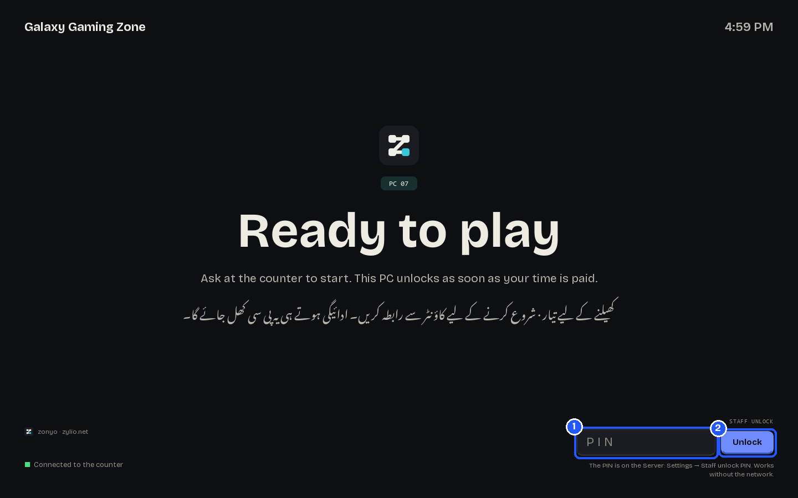

1. The **PIN** box and
2. **Unlock** button are for staff only (see [section 30](#30-the-staff-unlock-pin)).

**While playing** a small countdown card sits in the top corner. It turns amber near the end.

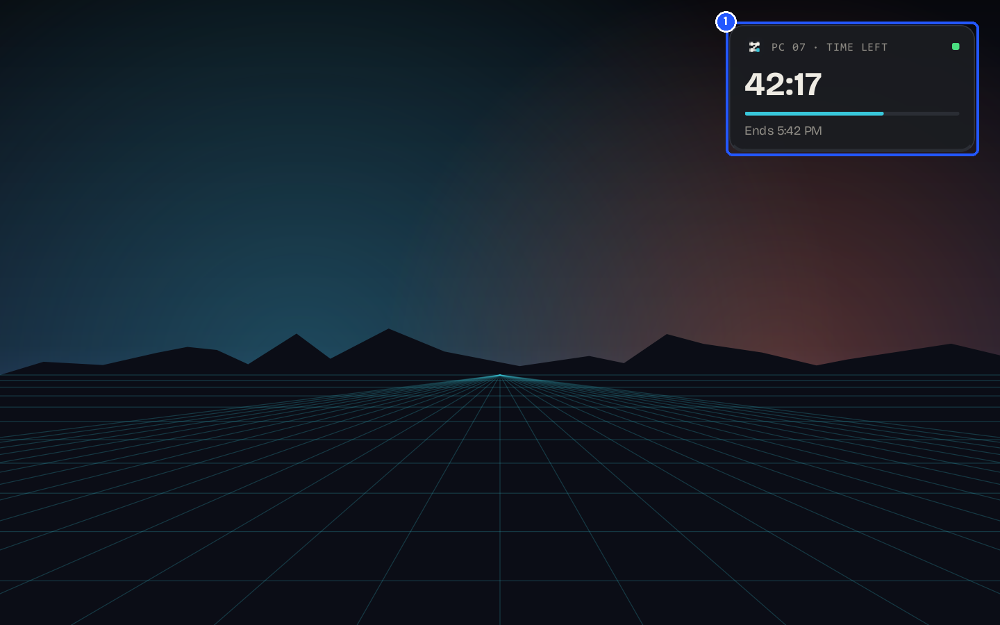

1. The time left on this PC.

**Before the end**, at 10 and 5 minutes, a notice appears and a voice says it aloud.

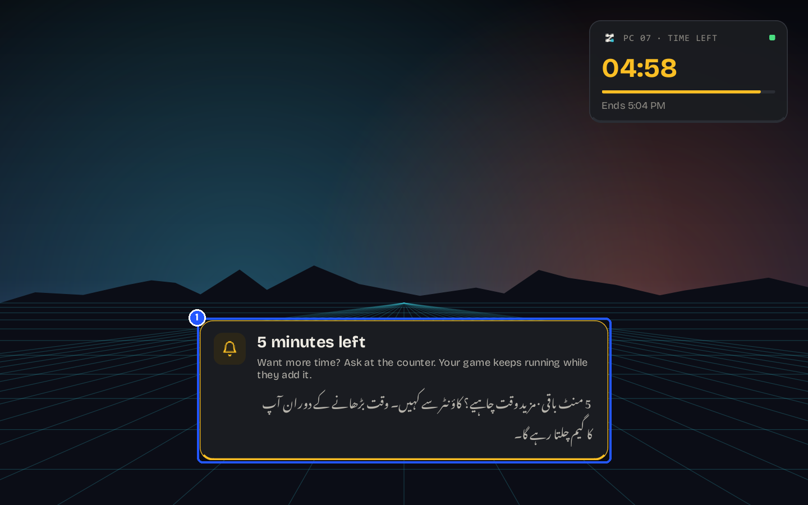

1. The warning, in the PCs' languages.

**At time up** the PC locks on every monitor and shows the time played and the amount to pay.

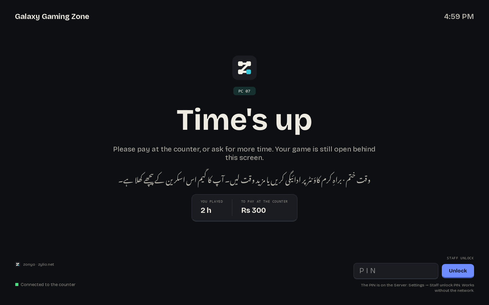

**When staff pause it** the PC shows **Paused by staff**, the customer's time is kept, and any message from the counter
appears on the screen.

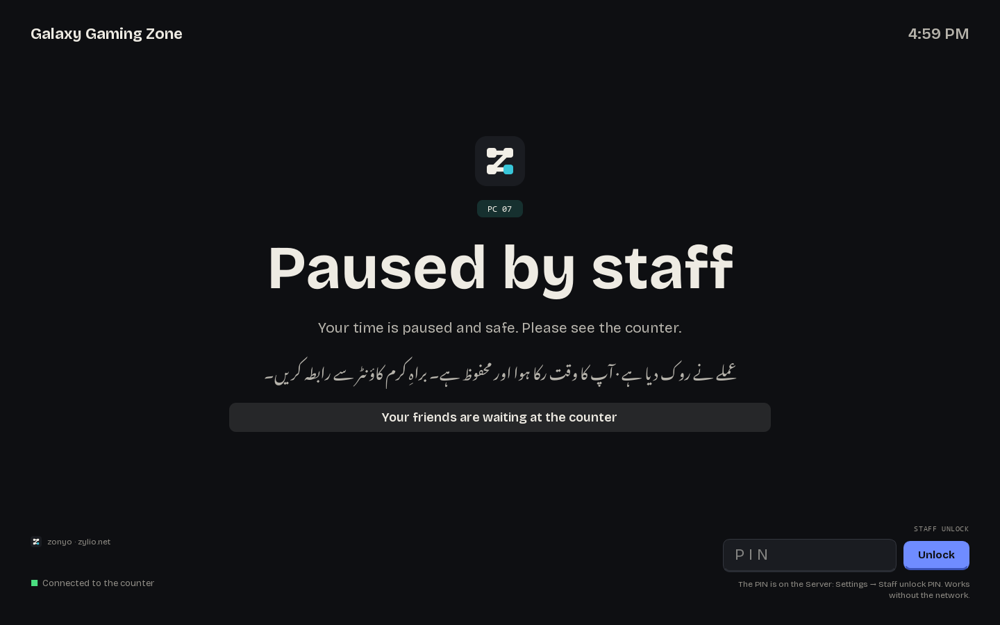

If a PC restarts in the middle of a session, the customer keeps their time. If the network drops, the PC keeps counting
down what was paid for and still locks at zero. Changing the Windows clock changes nothing: sessions count real time.

## 30. The staff unlock PIN

Every Server has a **staff unlock PIN**, shown in **Settings → Security**. Type it into the PIN box on a locked gaming PC
and click **Unlock** to open the PC by hand.

- It works even when the network or the Server is down.
- Wrong guesses lock the PIN box, and the wait doubles each time, even if the PC is restarted.
- Every use is written to the audit log.
- Change it any time in **Settings → Security**; running PCs get the new PIN straight away.

The PIN is for emergencies, not free play. Once a customer's time is up, a PC opened with the PIN locks again after a
minute while it can still reach the counter.

## 31. Why customers cannot get round it

- The lock covers every monitor, including one plugged in mid-session, and comes straight back if a game tries to cover
  it. It re-covers the screen when the resolution changes, and fits screens down to 800 × 600.
- Alt+Tab, Alt+F4, the Windows key and Ctrl+Esc do nothing while a PC is locked. The installer can also switch off Task
  Manager, Switch user and Sign out on gaming PCs.
- The customer's Windows account cannot close or pause zonyo Client, with Task Manager or any other tool.
- If the Client ever stops, it starts again by itself in about a second (within about a minute if it froze), with the lock
  and the customer's time exactly as they were.
- Deleting zonyo's files does not open the PC; the staff PIN still works.
- Windows' accessibility shortcuts, such as pressing Shift five times, are off while a PC is locked.
- Each gaming PC obeys only your Server. A zonyo Server someone brings in on a laptop is ignored.

---

# Part 7. Security, phone and upkeep

## 32. Security settings

Click **Settings**, then **Security**.

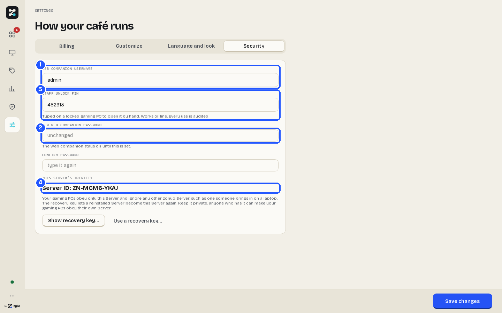

1. **Web companion username.**
2. **New web companion password**, typed twice. The web companion stays off until you set one.
3. **Staff unlock PIN** (see [section 30](#30-the-staff-unlock-pin)).
4. **This Server's identity:** its Server ID, and the buttons **Show recovery key…** and **Use a recovery key…**.

Click **Save changes**. Treat the counter PC itself as the key to the café: anyone who can use it can do everything zonyo
can.

## 33. Your recovery key: reinstalling the Server

If the counter PC breaks or Windows is reinstalled, install zonyo Server again (see
[section 2](#2-install-zonyo-server-on-the-counter-pc)). When the recovery key appears, click **I'm reinstalling: I have a
recovery key** (or later, **Settings → Security → Use a recovery key…**).

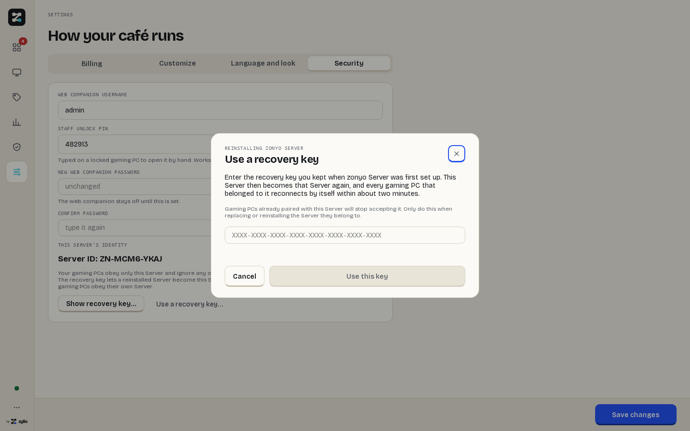

Type your key and click **Use this key**. Small mistakes such as lower case or missing dashes are fine; a real typo is
caught. Your gaming PCs reconnect by themselves within about two minutes and obey the new Server, with nothing to do on the
PCs.

To move to a new counter PC and keep your history too, copy the database across first (see
[section 36](#36-your-data-and-daily-backups)).

## 34. The web companion on your phone

The web companion is the Floor in a browser, for walking around the café. First set a password in
**Settings → Security** (see [section 32](#32-security-settings)). Then, in zonyo Server, click **⋯** at the bottom of the
menu → **Copy the web companion link**, and open that address on a phone or tablet on the café Wi-Fi. It looks like
`http://192.168.1.10:48080`.

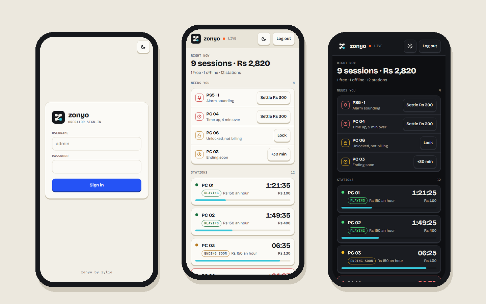

Sign in with the username and password from Settings. You can start a session (by the hour, a package or prepaid), add
time, end, lock, unlock, send a message and silence an alarm. Stations that need you are at the top. It follows the
Server's language and your phone's light or dark setting.

It works in any browser on your network, on a tablet or another PC too:

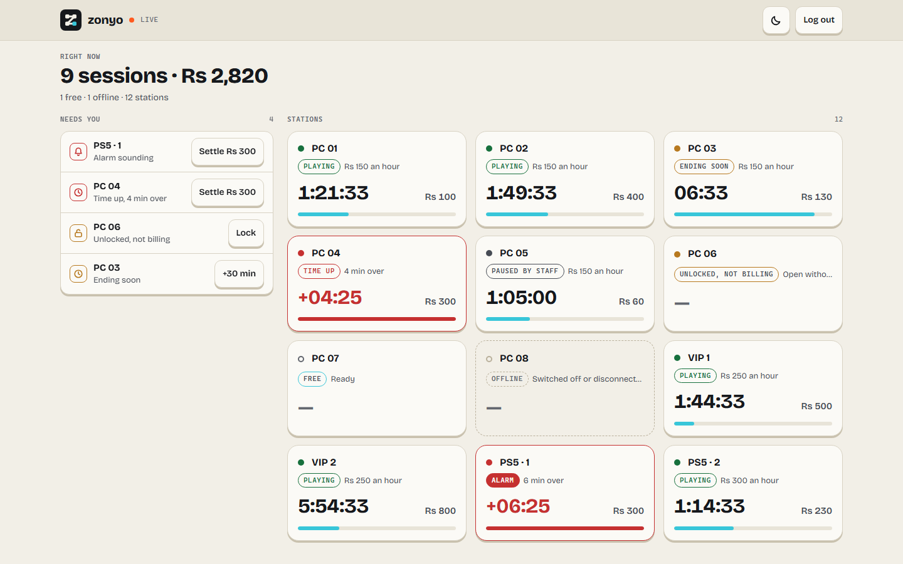

Wrong passwords are slowed down. Because every device on your network can reach it, the web companion refuses to switch
on until the default password is replaced.

## 35. Updates

**zonyo Server** checks for updates by itself, but never installs one on its own. When a new version is out, the menu shows
**Update ready**. Click it to read what is new, then click **Download and install**, and **Install and restart** once the
download is done. You can also choose **Later** or **Skip this version**. To check now, click **⋯** → **Check for updates
to this Server**.

**The gaming PCs** update from the Server: right-click a PC → **Update this PC**, or **⋯** → **Update every gaming PC**.

- A free PC updates at once, even at its lock screen, and comes back locked.
- A PC with a customer or an unpaid bill updates as soon as it is settled. A PC that is switched off updates when it next
  connects. Nothing is ever interrupted mid-session.
- No one has to click anything on the gaming PC. The update installs quietly behind the lock screen. The gaming PC needs
  the internet for this, to check the update's fingerprint before installing it.
- The side panel shows each PC's version and the update as it happens, and a notice says "PC 03 is now on …" when it is
  back.

## 36. Your data and daily backups

Your billing database is a single file on the counter PC:

- Windows: `C:\ProgramData\ChronosGG\chronosgg-hub.sqlite`
- Linux: `~/.local/share/ChronosGG/chronosgg-hub.sqlite`

(The folder keeps its old name so upgrades never lose it.)

**zonyo backs it up every day.** A copy goes into the `Backups` folder next to it, and the last 14 days are kept. To keep
a copy somewhere else as well, copy that folder to a USB stick now and then.

To restore or move the database: quit zonyo Server (**⋯** → **Quit**), copy the database file into place, and start zonyo
Server again.

Nothing leaves your network: zonyo has no cloud and sends your data nowhere.

## 37. If something goes wrong

**A gaming PC is not on the Floor.** Check the PC is switched on and connected to the same network. Then use **Add
station → Scan now** (see [section 5](#5-when-a-pc-does-not-appear)). If the PC is on another part of the network, add it
**By IP**.

**A station shows "not connected".** The PC is off, restarting, or lost the network. A running session keeps counting on
the PC and still locks on time. Click **Find this PC** in the side panel to reach it again.

**A PC is locked and the Server cannot be reached.** Use the staff unlock PIN on the PC (see
[section 30](#30-the-staff-unlock-pin)).

**The web companion will not open.** Set a password in **Settings → Security** first. Make sure the phone is on the café
Wi-Fi, not mobile data.

**zonyo Server will not start.** It tells you why, for example that it is already open (look for its icon next to the
clock). If it still does not start, restart the counter PC.

**The counter PC broke.** Install zonyo Server on another PC and use your recovery key (see
[section 33](#33-your-recovery-key-reinstalling-the-server)). Copy the database from the old disk or a backup to keep your
history.

## 38. Uninstalling

Open Windows **Settings → Apps**, find **zonyo Server** or **zonyo Client**, and click **Uninstall**.

Uninstalling zonyo Server keeps your database and its backups. It asks first, and deletes them only if you say so, so a
reinstall carries on where you left off. Uninstalling zonyo Client needs a Windows administrator; a customer's account
cannot remove it.

## 39. Words you will see

- **Server:** zonyo on the counter PC, where staff work.
- **Client:** zonyo on a gaming PC, which counts down and locks.
- **Station:** anything you sell time on: a gaming PC, a console or a table.
- **Session:** one customer's paid time on one station.
- **Settle:** end a session and take the money.
- **Cancel bill:** close a session without taking money, with a reason.
- **Package:** a fixed price for a block of time.
- **Prepaid:** the customer pays first; zonyo works out the time.
- **Paused by staff:** a PC locked by staff mid-session; the customer's time is kept.
- **Staff unlock PIN:** the number that opens a locked PC by hand.
- **Recovery key:** the key that lets a reinstalled Server take over your gaming PCs.
- **Web companion:** the Floor in a browser, on your phone.
- **Audit log:** the record of every staff action.

## 40. Get help

- zonyo's page: [zylio.net/software/zonyo](https://zylio.net/software/zonyo)
- Downloads and every version: [zylio.net/software/zonyo](https://zylio.net/software/zonyo)
- More from zylio: [zylio.net](https://zylio.net)

zonyo is free, and made by a small team at zylio. If something in this guide doesn't match your screen, tell us at
[support@zylio.net](mailto:support@zylio.net).
